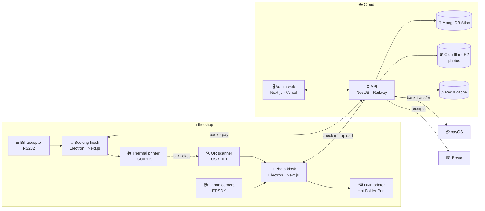

  I build products end to end — from the touchscreen a guest taps to the API and database behind it. 
  Currently building <b>Livi</b>, a photobooth system: photo kiosks, a booking kiosk, cash &amp; QR payments and photo printing.

### 🛠️ Tech Stack

  
  
  
  
  
  
  
  
  
  
  
  
  
  
    
  
  
  
  
  
  
  
  
  

### 🚀 Featured Projects

<table>
  <tr>
    <td width="50%" valign="top">
      <h4>📸 Livi Photobooth</h4>
      
Photo kiosks (Electron + Next.js) with Canon live view and DNP printing, a landscape booking kiosk with cash and bank-transfer payments, and a NestJS backend + admin dashboard.

      
   

      Private · in production
    </td>
    <td width="50%" valign="top">
      <h4>🧳 <a href="https://github.com/TRIPPIO-Smart-Booking-System/TRIPPIO_FE">TRIPPIO</a></h4>
      
Smart booking system — web front end. <a href="https://trippio-fe.vercel.app">Live demo ↗</a>

      
  

    </td>
  </tr>
  <tr>
    <td width="50%" valign="top">
      <h4>🎨 <a href="https://github.com/zus-pop/artchain-mobile">ArtChain Mobile</a></h4>
      
Mobile app built with Expo and React Native.

      
  

    </td>
    <td width="50%" valign="top">
      <h4>⚡ <a href="https://github.com/Hoangtri20003/Be-Ev-rental-system">EV Rental — Backend</a></h4>
      
REST API with real-time updates for an electric-vehicle rental system.

      
  

    </td>
  </tr>
</table>

### 🏗️ Livi — how it's built

One shop runs a **booking kiosk** and a **photo kiosk per booth**; they never talk to each other directly — everything goes through the API. A guest books and pays at the booking kiosk, takes the printed QR ticket to a booth, scans it and shoots.

<table>
  <tr>
    <td width="22%"><b>📸 Photo kiosk</b></td>
    <td>           </td>
  </tr>
  <tr>
    <td width="22%"><b>🧾 Booking kiosk</b></td>
    <td>        </td>
  </tr>
  <tr>
    <td width="22%"><b>⚙️ Backend API</b></td>
    <td>        </td>
  </tr>
  <tr>
    <td width="22%"><b>🖥️ Admin dashboard</b></td>
    <td>    </td>
  </tr>
  <tr>
    <td width="22%"><b>☁️ Infra & quality</b></td>
    <td>       </td>
  </tr>
</table>

### 📊 GitHub Stats

  
  
   
  

